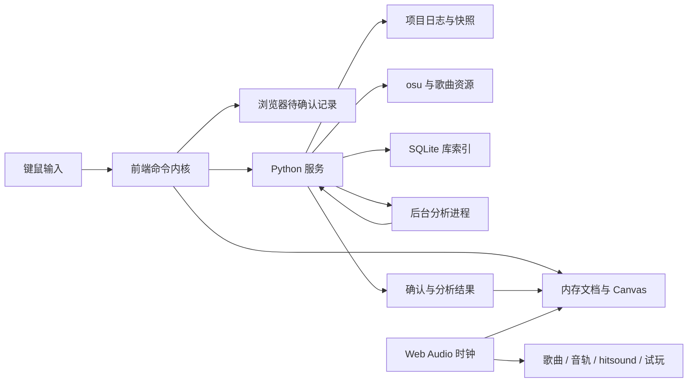

# SimpleManiaEditor 完整规划

规划日期：2026-10-07。状态：设计提案；本文中的架构、指标和交付物尚未实现或验证。

**路线更新（2026-10-07）**：用户确认可以调整技术栈，优先复用成熟代码。当前实现路线为基于 Luma 的 C#/.NET + Avalonia，见 [改造方案与源码审计](LUMA_ADOPTION.md)。本文保留为完整需求、功能语义与存储目标基线；Python/Web 具体架构及从零建设路线不再作为当前实施方案。

## 1. 产品目标与工作方式

构建可长期使用的 osu!mania 创作工具，先把 7K 日常写图流程做好，再完整覆盖官方 mania 编辑流程，并提供多轨道、排列库、版本历史和大规模本地库管理。

产品原则：

1. **本地优先**：基本功能不需要账号、联网或第三方服务。歌曲、谱面和辅助资料可以直接查看、复制、备份。
2. **低延迟**：放置、拖动、框选、滚动、播放和试玩不等待 Python 请求往返。
3. **数据可靠**：编辑操作可恢复；导出不破坏源文件；迁移可以中断和继续；不能把缓存当作唯一资料。
4. **7K 优先但不写死 7K**：列数、镜像规则、中央列、键位、颜色和排列映射由 KeyLayout 描述。其他列数保留模型与扩展空间，7K 是首要体验验收对象。
5. **可维护**：采用模块化单体；领域逻辑与 UI、文件系统、算法适配器分离。先实现明确接口，不提前搭建微服务或通用插件市场。
6. **分阶段交付**：每阶段都有可运行版本、自动化验证、已知限制和真实环境测试清单。未实现功能显示真实状态。

Codex 负责设计落地、实现、修复、测试、构建和文档。用户负责功能取舍、操作手感、真实音频设备及 osu! 验收；用户不需要维护代码或搭建开发环境。开发入口和发布版入口都应能一键启动。

## 2. 范围与默认假设

- 首发 Windows 本地应用体验：Python 服务运行于本机，Web 前端在本机 Chromium 浏览器中打开。后续可加入桌面外壳，核心逻辑不依赖外壳 API。
- “Web 前端”不等于云端网站。读写 Songs、索引和恢复由 Python 本地服务完成；浏览器负责交互与音频。
- `.osu` 兼容首先面向 osu!stable 的 mania 显式谱面；lazer 的文件格式兼容和内置试玩行为分别验证。lazer 的内部资源库不能假定为普通 Songs 文件夹，独立适配器后续评估。
- 默认读取 Songs 库；直接编辑 Songs 原文件作为可选工作流。优先复制到创作目录进行编辑。
- 首版集中于原生 mania 谱面，其他模式转换生成的 mania 不在首个可用版本承诺内。
- “完整官方编辑器功能”按官方 mania 工作流建立逐项对照表，包括 Compose、Timing、Design、菜单工具及文件管理；不能只把放键和 timing 做完就宣称完整。
- 故事板、视频、背景、break、sample events 等先做到读取、保留和导出，再补齐相关编辑和预览。完整 Design 功能安排在正式版兼容收尾阶段，未通过对照验收前保持未完成状态。
- 官方服务器上传、账号认证和论坛操作属于独立联网集成。如果“完整”包含直接上传，需要用户在兼容审计时确认；不与 `.osz` 导出混为一项。

以上是可调整的实施默认值，不是对原需求的删减。非 TODO 功能全部进入路线；用户标注 TODO 的功能只预留必要接口。

官方工作流依据：[编辑器](https://osu.ppy.sh/wiki/en/Client/Beatmap_editor)、[Compose](https://osu.ppy.sh/wiki/en/Client/Beatmap_editor/Compose)、[Timing](https://osu.ppy.sh/wiki/en/Client/Beatmap_editor/Timing)、[Design](https://osu.ppy.sh/wiki/en/Client/Beatmap_editor/Design)、[菜单](https://osu.ppy.sh/wiki/en/Client/Beatmap_editor/Menu)。实施 M0 时固定验收客户端版本及对照清单。

## 3. 技术架构

### 3.1 技术选择

| 层 | 建议技术 | 职责与边界 |
| --- | --- | --- |
| 前端界面 | TypeScript strict + React + Vite | 面板、表单、库浏览、设置；不驱动逐帧音符渲染 |
| 编辑内核 | 独立 TypeScript 模块 | 文档状态、命令、选区、吸附、变换、输入方案 |
| 轨道渲染 | Canvas 2D 起步，保留 WebGL 实现接口 | 可视区域裁剪、LN 命中检测、热力图；基准失败再引入 GPU 渲染 |
| 前端后台计算 | Web Worker | 大选区变换、时间网格、图形缓存；不阻塞 UI |
| 音频 | Web Audio + AudioWorklet | 同一音频时钟、预调度、混音、变速与变调 |
| Python 服务 | FastAPI + Pydantic | API、校验、目录访问、项目持久化、任务调度 |
| 通信 | HTTP + WebSocket | HTTP 处理资源/查询；WS 处理命令确认、任务事件与恢复同步 |
| 后台分析 | Python 独立工作进程 | 波形/频谱、BPM、难度；避免 CPU 分析占住服务线程 |
| 库索引 | SQLite + FTS5 | 元数据索引、筛选、检索、扫描进度；允许重建 |
| 项目与历史 | JSON、JSONL、普通资源文件 | 权威创作数据，不依赖全局 SQLite 才能打开 |
| Python 工程 | uv、Ruff、类型检查、pytest、Hypothesis | 锁定依赖、静态检查、语义/性质/故障测试 |
| 前端工程 | 固定单一包管理器、Vitest、Playwright | 类型检查、领域测试、浏览器端到端与性能验证 |

依赖版本在 M0 原型验证后固定到锁文件，不以永远追随 latest 作为兼容策略。NumPy 等分析库按功能需要加入；音频解码统一适配，必要时使用 FFmpeg，记录资源与分发要求。

### 3.2 数据流



关键约束：前端先应用合法操作并显示，再异步持久化。Python 是持久化序列的权威；前后端通过同一协议和一致性测试维持相同文档结果。服务拒绝操作时按已确认状态重建并重新应用仍然有效的待确认操作，不能静默保留不一致。

### 3.3 模块与目录边界

计划目录（本次只创建规划文档，不提前创建空代码树）：

```text
backend/
  src/simple_mania_editor/
    domain/            # 文档、音符、timing、命令校验与归约
    application/       # 打开、编辑、保存、迁移等用例
    api/               # HTTP / WS 接口
    formats/osu/       # lossless 文本解析和写回
    storage/           # 文件、日志、快照、索引
    library/           # Songs 扫描、检索、标签
    analysis/          # 音频与难度任务
    integrations/      # 外部计算器、Git、检查器适配
    platform/          # 路径、锁、启动和系统差异
  tests/
frontend/
  src/
    core/              # 独立于 React 的编辑内核
    editor/            # 轨道、工具、输入、工作区
    renderer/          # Canvas 与绘图接口
    audio/             # transport、混音、worklet、试玩
    library/           # 谱面库和排列库 UI
    history/           # 历史和 diff UI
    settings/          # 快捷键、模式、皮肤、布局
    workers/
    generated/         # 从协议生成；不可手改
  tests/
contracts/             # JSON Schema、协议版本、跨语言测试向量
fixtures/              # 自制小谱面和合成音频，不含用户真实 Songs
docs/                  # 规划、ADR、兼容矩阵、测试与发布说明
scripts/               # 启动、构建、检查、恢复工具入口
```

领域模块不导入 FastAPI、React 或文件系统库；UI 不自行修改音符数组；格式解析器不负责 UI 提示；分析器不直接修改文档。公共抽象只在出现实际复用时提取，避免泛化的 utils 大杂烩。

### 3.4 本地服务边界

默认只监听 `127.0.0.1`。服务验证会话令牌、HTTP Origin 和 WS Origin；文件接口通过已配置的 root ID 与资源 ID 访问，做路径规范化及越界检查。不能因为运行在 localhost 就允许任意网页读写本机文件。

单个项目设一个写入者，其他窗口经服务协调或只读。多标签页/多浏览器同时编辑同一文档时检测 revision 冲突，不做隐式 last-write-wins。联网协作启用后再引入其专用授权与冲突协议。

## 4. 领域模型、时间和操作协议

### 4.1 文档模型

- `Workspace`：多个项目、多个编辑 tab、布局和资源缓存。
- `Project / Mapset`：歌曲资源、共享资料、多个难度、独立 tracks、版本及备注。
- `BeatmapDocument`：一个难度的元数据、key layout、timing map、主按键轨道、事件等。
- `Track`：类型、稳定 ID、名称、排序、可见、锁定、静音/solo、导出策略与滚动关系。
- `Note`：稳定 ID、列、开始时间、可选结束时间、hitsound 属性；tap 与 hold 使用明确类型。
- `TimingPoint`：稳定 ID、原始值、明确的红线/绿线属性、同时间点稳定顺序。
- `Marker / Annotation`：库、谱面、时间范围或音符关联的分类标记和备注。
- `Pattern`：列数、相对拍位置、LN 长度、标签、来源、文本协议版本。
- `Version`：父版本、快照哈希、操作范围、时间、说明；不依赖文件名作为身份。

`.osu` 不自带音符 UUID；导入时分配项目内部 ID，由 sidecar 保存。外部改动后用旧内容、上下文和重复项顺序辅助匹配；有歧义时建立新的导入修订并展示 diff，不假装能永远准确追踪同一音符。

### 4.2 时间系统

三种坐标分开处理：绝对歌曲时间、拍坐标、滚动显示坐标。

- `.osu` 音符头尾以整数毫秒存储，内核沿用这个精度，放置时明确舍入；避免界面看似同拍而导出后相差 1 ms。
- timing 的 offset 与 beatLength 允许小数，保留原始十进制文本；计算使用十进制/有理数逻辑和跨语言测试向量。
- 网格和排列使用分数拍，例如 `1/7`，先计算精确拍位置，再在创建实际音符时统一量化到毫秒。
- 音频采样帧和播放时钟使用独立高精度位置，不反复回写音符时间。
- BPM 变更默认改变网格和滚动解释，不改变音符绝对时间；“维持拍位置重定时”作为单独显式批处理操作。
- SV 影响游戏滚动坐标；写图提供按时间、按拍和游戏 SV 预览视图。编辑视图不会因极端 SV 变得无法操作。
- 多段 BPM、负起始 offset、同一时刻红/绿线、跨 timing 段 LN、变拍号均列入核心测试。

时间点和 LN 编码依据：[官方 .osu 文件格式](https://osu.ppy.sh/wiki/en/Client/File_formats/osu_%28file_format%29)。读取与写回覆盖样本集、索引、音量、效果及未知数据，不仅处理 BPM/SV 两个字段。

### 4.3 所有谱面变更通过 command

操作结构至少包括：`schemaVersion`、`opId`、`projectId`、`documentId`、`actorId`、`baseRevision`、类型、目标 ID、确定的前后值、事务 ID、逻辑顺序和显示说明。

基础操作：添加/删除/更新音符、修改 timing、修改元数据与事件、添加/修改轨道、应用排列、更新标记、批量变换。拖动和重复放键先做瞬态预览，结束手势后合并成一个事务；数千音符的粘贴是一条批处理操作。

操作日志中保存**已经展开的明确变化**：中心对称工具生成两个音符时，不在回放时再次运行工具。操作不能依赖当前选择、当前播放位置、随机数或未记录的设置。重复 `opId` 必须幂等。

撤销和重做由反向变化组成新操作，不删除旧日志。普通撤销栈与完整历史分开；新编辑清空常规 redo，但旧历史仍可浏览或恢复为分支。恢复旧版本生成新的修订，不覆盖过去。

浏览、缩放、光标等会话行为可另存设置，不进入谱面撤销历史。快捷键、库标签等有自己的设置或资料事务，不混入音符撤销栈。

跨轨道复制和跨文档粘贴携带拍/时间锚点、列映射、LN 策略及声音资源引用。涉及多个文档的变更按事务提交，失败时整批不生效。

联网协作可以复用 command，但**广播 command 本身不等于完成协作**：仍需要排序、冲突处理、重复投递、断线重连、多人撤销和媒体资源交换。第一版协作优先服务器排序、明确冲突及区域锁，再评估 OT/CRDT；现在不实现未使用的 CRDT 框架。

## 5. 本地存储、保存、恢复与版本

### 5.1 可读项目格式

一个创作项目建议采用如下结构：

```text
MyMapset/
  Artist - Title (Mapper) [Difficulty].osu
  audio.mp3
  background.jpg
  samples/
  .sme/
    project.json             # 格式版本、项目 ID、资源与难度清单
    documents/<id>.json      # 内部文档、UUID、草稿轨道等完整状态
    annotations.json         # 标签、状态、备注与范围标记
    journal/<segment>.jsonl  # 操作日志，分段、校验、可检查
    snapshots/<hash>.json    # 恢复与命名版本使用的状态快照
    versions.json            # 版本图和说明
    assets.json              # 资源哈希与版本引用
    recovery/                # 中断写入与恢复事务记录
```

格式是公开的 UTF-8 文件，`.sme` 是辅助资料目录，不是加密容器。项目完整状态以文档、快照和日志中的已确认 revision 为准；根目录 `.osu` 是明确记录 revision 的兼容输出。每次保存需维护清单，防止多个状态来源互相覆盖。

未编辑内容尽量保留原文；在首次建立项目时保留源 `.osu` 基线。原位 Songs 编辑的 sidecar 可放应用资料目录，以免污染原 Songs；需要提供“导出带全部资料的项目”功能。

Songs 中的标签备注保存在独立可读目录，身份与路径分离。应用 SQLite 同步这些资料供搜索；搬目录、重建索引和重装应用时可重新关联。对完全相同的多份谱面保留 occurrence 身份，并明确标签是跟随内容还是跟随该副本。

SQLite 保存库索引、位置记录及任务状态。波形、频谱、解码音频和难度结果放缓存目录；均可清除和重算。用户注释与历史不混入可清理缓存。

### 5.2 写入可靠性

保存分成不同状态，界面应区分“有未保存变更”“正在落盘”“恢复日志已持久化”“兼容文件已保存”。收到消息或写进内存不能显示为已持久化。

1. 前端校验并应用 command，记录待确认操作；IndexedDB 提供浏览器中断后的辅助恢复。
2. Python 串行校验 revision，追加带长度/校验信息的日志，flush/fsync 后返回持久化确认。可短时间批量刷盘，但确认必须在对应批次持久化之后。
3. 定期创建快照并记录其覆盖的日志位置，控制恢复时长。初始建议 30 秒或 200 个事务触发，后续按测量调整。
4. 显式保存 `.osu`：生成临时文件、重新解析校验、flush、在同一文件系统中替换目标、保留前一个有效版本。
5. 多文件项目保存使用 staging 和事务清单；文件系统没有整个 mapset 的原子替换保证，启动时完成或回滚中断事务。
6. 恢复时读取最后一个有效快照，再回放完整且校验正确的日志。损坏尾部隔离保存，不默默删除整段历史。
7. UI 提供恢复比较和“另存恢复副本”；服务中断时停止显示已保存，重连后按 opId 补交，避免重复放键。

IndexedDB 不是权威备份：浏览器清理、端口/Origin 变化或换浏览器都可能使其不可用。可用时作为第二条恢复通道，最终仍以普通项目文件与持久化确认为准。

默认命令日志目标落盘延迟不超过约 250 ms，具体性能见验收文档。未确认的最后一小段操作存在丢失可能；硬件故障也不能靠同一块硬盘上的历史消除。提供可选备份目录、定时项目备份、明确的保留策略，绝不把自动保存描述成永久零丢失保证。

### 5.3 外部改动和格式升级

打开时记录源文件哈希，保存前检测外部改动。发生改动时显示重新加载、比较合并或另存选项，禁止静默覆盖。外部更新、项目迁移与版本恢复均作为可追溯的新基线。

所有项目格式和操作协议带版本。升级先备份、验证再替换；新版功能存在时旧版只读或明确拒绝。更新应用不自行重写所有 Songs。

### 5.4 版本管理路线

先实现内置快照、命名版本、分支、比较与恢复。diff 按音符稳定 ID 展示增删、移动、LN 头尾变化、hitsound、timing 和元数据变化；支持按列/时间/轨道过滤及并排或叠加比较。

再实现可选 Git 适配器：初始化项目仓库、提交、分支、历史和外部改动检测。Git 对普通文本可见，但不作为实时撤销、自动保存和跨轨道 diff 的唯一实现。操作日志、快照及 Git 提交分工清晰，不把每次鼠标移动写成提交。

音频等二进制资源不随每条 command 复制；命名版本记录资源哈希。若用户需要资源回溯，采用按内容保存的资源副本或可选 Git LFS，并提供体积统计。历史清理不能删除仍被版本引用的资源。Git 合并冲突通过谱面语义比较辅助处理，不能承诺自动正确合并所有 LN/timing 改动。

## 6. 几万张谱面的库管理与迁移

### 6.1 资料来源

支持多个 Songs root 和多个创作 root。每个 root 可配置读取/写入权限、扫描状态、目录排除和路径迁移。谱面分为 mapset 与 difficulty 两层，UI 可按任一层浏览。

库资料包含元数据、列数、长度、音符数、基础 BPM 范围、来源、用户标签、收藏、发布状态和自由备注。官方 metadata Tags 与用户的私有标签使用不同字段，私有资料从不写入 `.osu`。

标签可有类型与颜色，状态如“未发布”“待修订”“排列参考”；备注可附在整套、单难度或时间范围。支持保存的筛选视图，例如“创作库 + 7K + 未发布”。

### 6.2 增量索引

- 首次扫描先遍历目录、读取 `.osu` 头部元数据；完整音符分析、音频解码、封面生成和难度计算按需或低优先级执行。
- 用路径、size、mtime 等快速判定变化，需要身份确认/外部编辑检测时才计算内容哈希。避免每次启动哈希全部音频。
- 扫描有批次、进度、暂停、取消和断点。限制 I/O 和工作进程数量，写图/播放任务优先。
- 文件监听合并短时间事件，并配合低频校验扫描；不能假定大规模目录 watcher 永不漏事件。
- 索引更新事务化，删除采用缺失标记，目录暂时掉线不能当作批量删除用户备注。
- 列表虚拟化、游标分页、后台查询，浏览几万条时不将全部元数据塞进 React 状态。
- 搜索规范化 Unicode 和大小写，支持中英文/日文、字段过滤及标签组合。采用 FTS5 与结构化索引；短中文词另设索引/受限候选搜索。
- FTS5 trigram 的 1～2 字搜索不能直接按长词查询处理，必须专门测试；官方文档说明了其短子串限制：[SQLite FTS5](https://www.sqlite.org/fts5.html)。
- 第一个规模基准用 50,000 个 mapset / 200,000 个 difficulty 文件，另建极端单套多难度样本，避免“几万张”单位不同造成误判。

### 6.3 Songs 双向迁移

“迁移”拆成复制、移动和同步导出三种操作；默认安全复制，用户明确选择移动时才移除源文件。整个 mapset 的音频、背景、视频、`.osb`、样本等依赖纳入清单，共用资源不能因迁移某个难度而误删。

流程：扫描依赖和冲突 → 展示目标与资源清单 → 校验空间 → staging 复制 → 逐文件哈希校验 → 完成目标事务 → 更新库身份/位置 → 移动模式再移除确定未改动的源。

文件名/ID 相同不能直接覆盖；支持跳过、保留两份或显式替换。迁移中出现源文件变化、文件锁、磁盘不足、路径过长、权限错误都保留事务状态，支持重试或回滚。跨盘移动按复制与验证处理，不能依赖 rename。

创作库 → Songs 默认输出游戏兼容文件，草稿轨道和历史保留在创作库；Songs → 创作库建立独立项目身份并记录来源。导出 `.osz` 不包含应用缓存与内部历史，另提供完整项目备份格式。双向映射记录上次同步基线，双方都改动时显示 diff 而不是覆盖。

## 7. 编辑功能与具体语义

### 7.1 基础编辑与官方兼容

- 创建 mapset 和难度、音频导入、元数据/难度参数、preview time、书签、跳转、循环播放、节拍器。
- `.osu`/`.osz` 打开与导出；tap/LN 放置、删除、头尾拖动、批量长度调整、选区与多选。
- 框选采用时间与列范围；LN 可按头部或与框相交选中，提供一致的可配置规则。
- 复制/剪切/粘贴、整体时间/列平移、列循环平移、左右翻转、时间反转、按节拍调整和 resnap。
- LN 头尾不能静默穿越；明确阻止、交换或转换的工具语义。同列冲突采用保留并提示、跳过、替换等显式策略；导入历史异常时保留原文并列出问题，不擅自清洗。
- timing/SV 面板、批量操作、按范围曲线生成、红绿线样本集/音量/效果编辑。生成的 SV 曲线导出为普通 timing points。
- hitsound 对象属性、继承、默认样本、normal/addition、自定义文件、音量、批量应用和试听；LN 头/尾/持续声音的编辑与试听按固定客户端语义验证。
- 背景、视频、break、sample event、故事板资料，以及官方菜单中适用于 mania 的工具逐项核对；保留未知 section、字段、位标记和原始顺序。
- `.osz` 解包验证路径，不能将归档内路径写出导入目录；损坏文件提供定位信息和原始文件保留。

### 7.2 多轨道

“轨道”与“列”必须在 UI 中区分：一个按键轨道包含 7 个列；草稿按键轨道也是完整 7 列，而不是增加游戏按键数。

| 轨道 | 默认用途 | 导出/同步规则 |
| --- | --- | --- |
| 主按键轨道 | 正式谱面 | 默认始终显示；一个 difficulty 默认仅导出这条 |
| 草稿按键轨道 | 排列草稿、备选写法 | 手动合并、复制或选作导出；不自动混入主轨道 |
| 音频轨道 | 参考音频、局部素材、混音 | 独立 offset、gain、mute/solo；`.osu` 只能指定主要歌曲，导出混音须显式生成新音频 |
| hitsound 编辑轨道 | 编辑与试听声音 | 对象声音绑定主音符；独立声音事件只能映射到兼容 sample event 或明确提示不可导出 |
| 其他谱面对照轨道 | 抄排列、观察其他难度/版本 | 默认只读，可复制；独立滚动或绑定滚动 |

同步分成视图滚动同步、播放位置同步和 beat/time 对齐方式，三者不混为一个开关。不同歌曲的对照允许 offset/拍锚点对齐；不同 BPM 图不能直接假定相同毫秒等于同一拍。

所有轨道支持必要的锁定/可见/排列设置；主轨道始终可访问。跨轨道粘贴先预览范围、列映射和冲突；导出前显示哪些轨道进入游戏文件及不支持的功能。

### 7.3 多模式、输入与 UI

- 完整模式：LN、SV、hitsound 和完整面板。
- 最小模式：隐藏高级声音/SV 工具，聚焦放键；已有声音/SV 保留，不因模式切换自动清空。
- 最小 RC 模式：禁用新建 LN 和拖出 LN；已有 LN 仍显示并提示，批量转换是独立可撤销操作。
- 模式以能力配置描述，不分叉成三个代码库。能力禁用同时约束 UI、快捷键和工具执行。
- 默认键鼠方案参照官方 editor；增加其他输入 preset 时只替换输入映射，不改动 command。
- 快捷键按 library/editor/playtest/文本输入等上下文作用，检测冲突、导入/导出设置；播放和试玩按键与编辑输入分离。
- UI 方案先做官方习惯布局、多轨道工作台、左右比较布局；共享组件与内核，支持面板显隐、尺寸和布局保存。

### 7.4 网格、播放和试玩倍率

| 类型 | 默认预设 |
| --- | --- |
| 网格 | 1/1、1/2、1/3、1/4、1/5、1/6、1/7、1/8、1/9、1/10、1/12、1/16、1/24、1/32、1/48、1/64 |
| 编辑播放 | 0.1x、0.25x、0.5x、1x、2x |
| 试玩 | 0.25x、0.5x、0.75x、0.9x、1x、1.1x、1.25x、1.5x |

均支持自定义值、修改预设与恢复默认。网格可以叠加多个分母，分别控制视觉线和实际吸附网格。数值边界明确且经过验证，不接受零、负数或导致资源无限增长的输入；初期至少覆盖全部默认倍率。

速度、是否保持音高、独立半音偏移分开设置；修改播放速度不修改谱面时间或 timing。低至 0.1x 的保音高播放必须实测，不能只依赖 HTML audio 的浏览器默认行为。

### 7.5 中心对车和 LN 转换

中心对称工具定义一个时间区间 `[a,b]` 和列范围 `[l,r]`：

- tap：`t' = a + b - t`，`c' = l + r - c`。
- LN：`start' = a + b - end`，`end' = a + b - start`，列同上；不能只翻转 LN 头而不处理尾。
- 默认时间坐标中心对称；另外提供拍坐标中心对称，跨变速段时两者结果可能不同，界面明确显示。
- 左右镜像是单独模式，只变列；可单独选择时间反转。
- 支持局部列范围与掩码；非对称掩码提前提示。正中点/中央列重复音符去重，冲突策略与普通放键相同。
- 自动生成内容和用户输入属于一个事务，防止递归生成；支持预览和临时关闭。

面转米提供头部单键、头尾双键、按选定网格拆分等可选规则，首个默认规则由用户体验验收确定；保留声音映射、检测同列冲突并可撤销。米转面保留转换器接口，暂不实现。

### 7.6 排列编辑、库与文本分享

没有歌曲也可创建排列文档：选择列数、基准 BPM、节拍范围，使用同一编辑内核与合成节拍器。保存排列包含音符相对拍位置、LN 拍长、可选声音资料、标签及来源。

文本格式建议采用 `SMEPAT/1` 版本头和可读 JSON，使用分数拍，不依赖某首歌的绝对 offset。默认直接输出可复制文本；短编码/压缩作为可选格式，接收端都应可以验证和预览。

剪贴板同时提供应用结构化数据与纯文本分享形式；普通复制可配置官方 timestamp 文本或 pattern 文本，另提供“复制为排列代码”明确入口。官方 timestamp 只包含对象位置，并不足以表达完整 LN 与声音，不能把它当成完整排列协议：[官方 timestamp 格式](https://osu.ppy.sh/wiki/en/Modding/Timestamp)。

粘贴可以保持拍位置、保持毫秒距离或按目标 BPM 缩放；跨 timing 段按拍映射。列数不一致时给出列映射预览，不自动裁掉音符。放置游戏式预览支持移动、镜像、列旋转和重复铺排，确认后提交 command。

文本解码限制长度、对象数和数值范围，不执行任何代码。声音文件不能凭文本凭空共享：缺失时提示并保留引用；可另外导出带资源的排列包。

### 7.7 皮肤与多文档

自带单色/双色/三色主题和柱面/淡面/细面 note 样式；游戏皮肤与编辑器 UI 主题分开设置。导入 osu!mania `skin.ini` 与必要图片、列宽/颜色、tap、LN 头尾与面身配置；缺失资源按清晰规则回退。动画/复杂资源按兼容矩阵逐步补齐，不能宣称任意 skin 都完全一致。

多谱面 tabs 共享歌曲缓存，各自拥有文档 revision、选区、撤销栈和未保存状态。一个歌曲 transport 可驱动同步视图；音频焦点明确，避免多个 tab 同时播放。

支持不同难度、历史版本和草稿并排/叠加比较。历史版本默认只读；从历史继续编辑创建分支。同步按 time 或 beat 选择，并允许独立滚动。

## 8. 音频、可视化和低延迟

### 8.1 编辑与渲染

音符按列和时间建立索引，只查询可视窗口以及与窗口相交的 LN。超长 LN 即使头部在窗口外也必须绘制和命中。时间缩放很小时使用密度摘要，不能绘制数十万个重叠对象。

Canvas 按网格、音符、选区/光标等层缓存；拖动预览不重建全谱。React 只更新面板状态，requestAnimationFrame 渲染读取独立内核中的轻量视图数据。批量操作在 Worker 中准备结果，提交保持原子性。

默认 60 Hz 可流畅编辑，支持高刷新率；不能把 60 fps 通过当成 144 Hz 也通过。性能指标必须记录机器、浏览器、分辨率和数据集，详见验收计划。

### 8.2 统一音频 transport

Web Audio 时钟负责播放位置，不使用 Python 定时器、网络到达时间或 UI 的 setInterval 驱动节奏。transport 管理歌曲位置、倍率、循环、seek、暂停和音轨对齐；变速后时间映射分段记录，不能使用一个固定乘法处理全部历史位置。

UI 使用输出时间戳与显示补偿对齐正在听到的位置；输入判断映射到相同时间轴，并区分系统/设备校准与谱面 offset。可获取的输出时间戳能力参考 [AudioContext.getOutputTimestamp](https://developer.mozilla.org/en-US/docs/Web/API/AudioContext/getOutputTimestamp)。

hitsound 和节拍器提前调度，立即按键反馈走前端；不每次击键调用 Python。声音按真实输出速度播放，触发位置映射到变速歌曲时钟；是否连同素材变调单独设置。

1x 和联动变调路径先做简单、低延迟实现；保音高与独立变调通过 AudioWorklet 中的 DSP 引擎实现。参考候选 [AudioWorklet](https://developer.mozilla.org/en-US/docs/Web/API/AudioWorklet) 与 [SoundTouchJS AudioWorklet](https://github.com/cutterbl/SoundTouchJS/blob/master/packages/audio-worklet/README.md)，最终由 M0 质量与时延原型决定。

保音高存在处理窗口/缓冲延迟，必须测量并补偿。0.1x 等极端倍率优先保证正确时间轴，允许质量档和后台预处理缓存；缓存按源资源哈希、算法版本、rate、pitch 参数区分。不能通过“关闭保音高”来伪装完成默认需求。

长音频限制解码驻留内存，按实际大小选择完整解码或分块/流式路径。音频缓存按 LRU 管理，多文档共享同一资源，不复制整份 PCM。seek、循环边界和 rate 变化需预热/交叉淡化，不能产生上一播放位置残留声音。

浏览器失焦、系统睡眠、音频设备切换或音频上下文暂停时冻结/重新校准 transport；试玩失焦默认暂停并清除按键状态。自动化不能替代硬件端到端延迟测试。

### 8.3 波形与频谱

波形缓存采用多分辨率 min/max 或峰值层级；全曲览和高倍率局部显示选择不同粒度。频谱通过后台 STFT 分块生成，保存时间分片/LOD，支持频率范围、线性/对数轴与音轨选择。

音符编辑不触发音频重新分析；缓存以音频内容和分析参数为 key。显示与分析可独立关闭，任务有进度/取消，后台分析期间编辑和播放仍需通过性能门槛。

### 8.4 试玩

内置试玩先实现 7K、LN 头尾、OD 判定、输入反馈、自动播放、循环片段和统计；提供按键绑定、scroll speed、offset 校准。正式分数算法和 stable/lazer 行为分别列为兼容目标，编辑试玩不默认宣称成绩可提交或完全等于官方成绩。

试玩消费只读文档快照，开始时记录 revision。编辑发生后提示重载或在明确边界更新，不能在判定过程中无序更换谱面。倍率与变调沿用同一音频引擎，判定时间窗口如何随 clock rate 变化按目标客户端验证。

提供导出/打开 osu! 的真实客户端测试入口；通过系统支持的导入方式或显式打开操作衔接，不承诺 stable/lazer 都支持同样的自动跳入试玩协议。

## 9. BPM/offset 与难度分析

### 9.1 自动测定 BPM 和 offset

采用可审查的分析流程：音频归一化/多频带 onset → 局部节奏候选 → 连续 tempo 路径与变化点 → offset/拍相位拟合 → 段落与置信度预览。

先交付单 BPM 候选和人工锚点拟合，再交付变速分段与连续变化处理。分析结果是建议，不自动重写 timing；用户试听节拍器、调整倍率/锚点后，通过一条事务接受选定区间的结果。

支持 0.5x/1x/2x 等 BPM 等价候选与自定义倍率。无明显节奏、弱起、长休止、切分、复合拍与现场录音提供低置信度和多候选，禁止输出虚假的确定值。逐段调整无需重新分析全曲。

验收区分合成音频的已知真值测试、音乐样本与用户真实变速谱面。复杂连续变速用有限个红线近似时显示拟合误差和点数，保留人工 editing 流程。

### 9.2 难度算法与版本

定义 `DifficultyProvider`：算法 ID、来源 URL、版本/commit、支持列数与参数、全谱结果、按时间/音符的指标、精确/近似标记、取消及缓存能力。

官方 strain based 优先使用可对照官方实现的 Python 移植或独立计算器适配；以固定官方 commit 的结果作为 oracle。输入语义、rate、排序、LN 预处理和分段聚合都须一致，不能只把公式名写成“官方”就认为一致。参考：[官方 mania strain 实现](https://github.com/ppy/osu/blob/master/osu.Game.Rulesets.Mania/Difficulty/Skills/Strain.cs)。

Sunny 优先评估作者的 Python 项目 [Star-Rating-Rebirth](https://github.com/sunnyxxy/Star-Rating-Rebirth)。实施前确认具体版本、7K 行为、导出接口与使用/分发许可；适配器接口不依赖直接复制上游代码。

已查阅的 [官方仓库移植 PR #36342](https://github.com/ppy/osu/pull/36342) 明确说明存在算法差异和全谱预处理需求，且该 PR 已关闭等待重构；不能据此推断 Sunny 已成为当前官方算法，也不能把所有同名移植当成一致实现。M7 接入时重新核对上游状态并锁定来源。

每音符 strain、区间峰值、整体星级、局部密度属于不同指标。UI 标注单位、时间窗口和算法版本；不能把 per-note strain 随意命名成官方每键星级。

### 9.3 实时假设预览

实现顺序：缓存的全谱曲线 → 已有音符/区间指标 → 单个候选放键或 LN 伸缩 → 可选轨道热力图。

指针悬停或 LN 拖动时只评价最新候选，采用防抖、优先级、取消与 revision 标记，旧结果不能覆盖新文档。默认显示该候选的变化和受影响区间；同时评估整张网格所有位置仅在性能允许时启用。

官方 strain 的改动可能影响后续累积状态；Sunny 的预处理/平滑也可能依赖全谱。只有 provider 能证明增量重算等价时才显示“精确”；否则立即返回明确的近似预览，并后台重算精确值。批量假设不得阻塞放键，超预算时关闭热力图而保留编辑和单候选分析。

## 10. TODO 功能的扩展空间

| 功能 | 现在预留 | 后续实施边界 |
| --- | --- | --- |
| 自定义 AI API 元数据 agent | Provider 配置、可取消任务、建议结果结构、元数据 command | 支持自定义地址/模型；API key 独立存储；建议预览后批量接受，不直接改文件 |
| AI general check / MapsetVerifier | CheckProvider、带时间/音符定位的问题结构、规则版本、修复建议 command | 先接确定性规则，再加 AI 解释/建议；通过检查不等于保证可 ranked |
| 米转面 | NoteTransform 接口、范围/参数/冲突预览 | 配对、长度、声部策略由用户确定，结果可撤销 |
| 局域网/内网穿透协作 | actor/opId/revision、资源哈希、session 事件和 WS 边界 | 服务器排序、区域锁、资源同步、断线恢复、权限与多人撤销；互联网连接单独启用 |

不提前实现 agent 框架、通用联网平台或协作算法。MapsetVerifier 当前仓库采用 GPL-3.0，接入方式和项目发布许可需在实施时明确；先评估其实际接口，不假定有稳定的 headless CLI/API：[MapsetVerifier 项目](https://github.com/Naxesss/MapsetVerifier)。

## 11. 分阶段路线与验收门槛

不按日历给未经验证的工期承诺。先完成 M0 的技术风险验证，再估算后续工作；每个阶段可以拆成多个独立可运行增量，但不能跨过数据安全门槛。

| 阶段 | 交付内容 | 完成标准 |
| --- | --- | --- |
| M0：工程与风险原型 | 依赖/目录边界、协议 v1、时间模型、`.osu` 小型 parser、7K 渲染/音频/保音高原型、官方功能对照表 | 验证 0.1x/2x、基本时钟映射与压力渲染；记录浏览器/设备限制；锁定架构 |
| M1：最小编辑闭环 | 打开/新建 7K、tap/LN、选区、复制粘贴、撤销重做、保存、基础 1x 播放、命令日志 | 自制与代表样本读写、回放一致；放键到持久化闭环；基础中断恢复 |
| M2：首个日常可用版本 | 精确 timing/网格、手动 BPM/offset、常用变换、波形、自动保存/恢复完整流程、简单试玩、最小/RC 模式、快捷键 | 写完一段真实 7K 谱面可存储并在 osu! 打开；故障测试通过；用户可开始日常试用 |
| M3：完整音频与高级基础 | SV、hitsound 完整编辑/试听、多倍率保音高/变调、试玩兼容细化、频谱 | 全部默认倍率可用；声音继承/LN 语义有官方对照；分析不拖慢交互 |
| M4：库与双向迁移 | 多 root、增量索引、标签/备注/搜索、收藏/未发布视图、迁移事务、`.osz` | 50k/200k 基准与搜索通过；迁移中断、冲突、共享资源测试通过 |
| M5：7K 创作增强 | 多轨道、多文档、对照同步、中心对车、面转米、无歌曲排列、排列库/文本分享 | 跨轨道/跨 timing 粘贴不丢 LN；草稿不混入导出；共享文本可正确往返 |
| M6：版本与工作区 | 命名版本、分支/恢复、语义 diff、并排版本/难度、可选 Git、更多皮肤/输入/UI preset | 历史与编辑互不干扰；版本恢复和资源引用可靠；常见 mania skins 兼容矩阵通过 |
| M7：自动分析 | 变速 BPM/offset、官方与 Sunny 算法、局部曲线、单候选预览、可选热力图 | 与固定来源 oracle 比较；置信度/近似标记准确；过时结果和性能退化测试通过 |
| M8：正式版兼容收尾 | 完整官方 mania 对照审计、Design/事件/故事板编辑与预览补齐、分发/升级、全局回归和文档 | 未标 TODO 的需求逐项通过；官方功能缺口逐项说明并补齐；真实使用验收 |
| M9：TODO 扩展 | AI 元数据、general check、米转面、联网协作 | 每项独立规划和验收，按用户优先级决定 |

M1 必须有基础操作日志和中断恢复，不能先上线不可靠的编辑器再补救。M2 是日常试用点，M8 才是完整非 TODO 范围的正式交付点。

依赖关系：M0 → M1 → M2；M3/M4 在底座稳定后可按用户需求交换优先级；M5 使用 M1 文档/命令模型和 M4 资料身份；M6 使用稳定 IDs/快照；M7 使用音频任务与多轨道数据；M8 审计全部功能。这里的模块独立性不表示需要多个 agent 并行开发。

### 11.1 原需求追踪表

| 原需求 | 首次交付/完整交付 |
| --- | --- |
| 官方编辑器功能、`.osu`、timing、SV、LN、hitsound、playtest | M1～M3；官方完整对照 M8 |
| 撤销/重做、复制/粘贴、框选、整体/循环平移、翻转 | M1～M2 |
| 波形、频谱 | M2、M3 |
| 独立创作目录、读取 Songs、大规模性能 | M1 项目目录；M4 完整库 |
| 标记、备注、筛选/搜索、收藏、未发布 | M4 |
| Songs 双向迁移 | M4 |
| 多按键/草稿/音频/hitsound/对照轨道、轨道间复制 | 模型 M0～M1；完整 M5 |
| 类 Git 版本管理/实际 Git | M6 |
| 操作轨迹、自动保存、崩溃恢复、command | M1 基础；M2 可靠性；M6 浏览/diff |
| 完整/最小/最小 RC 模式 | M2；完整能力随 M3 补齐 |
| AI 元数据填充 | M9 TODO |
| agent general check / MapsetVerifier | M9 TODO |
| 自动 BPM/offset、变速谱面、BPM 倍率 | 手动 M2；自动完整 M7 |
| 多倍率/自定义/自定义预设网格 | M2 |
| 多倍率播放、保音高/变调 | M3 |
| 多倍率试玩、保音高/变调 | M2 基础；M3 完整倍率 |
| 官方 strain + Sunny、每时间/音符局部分析 | M7 |
| 放键/LN 伸缩假设难度、轨道热力图 | M7；热力图按性能结果开关 |
| 中心对车等工具 | M5 |
| 多种键鼠方案、官方习惯默认 | M2 默认；M6 更多方案 |
| 无歌曲排列编辑、排列库、文本导入/分享 | M5 |
| 自定义快捷键 | M2 |
| 自带多皮肤、导入 mania skin | M2 基础；M6 完整常见兼容；M8 收尾 |
| 多谱面编辑、版本/难度并排 | M5；版本比较 M6 |
| 面转米 | M5 |
| 米转面 | M9 TODO |
| 多种 UI 方案 | M5 多轨道；M6 presets |
| 局域网/内网穿透共同创作 | M9 TODO |

## 12. 开发纪律、交付与关键决策

开发先用自制小谱面和合成音频建立测试向量，再在用户授权的真实文件副本上验证。正常开发和自动化不会修改真实 Songs。实现每项功能同步更新协议、兼容清单与必要文档；具体测试门槛见 [验收与测试计划](ACCEPTANCE.md)。

每个可用增量应交付：一键启动入口、可复现依赖/构建、完成范围、验证记录、已知限制和真实环境测试步骤。用户反馈进入可复现的问题记录，由 Codex 修复并加入对应回归测试。

项目仓库保持整洁：用户歌曲、构建物、分析缓存、虚拟环境、秘密及个人路径不入库；依赖锁文件、迁移脚本、测试样本和 ADR 入库。用小而完整的变更推进，不长期堆积临时代码或多个互相替代的实现。

需要用户逐步把控的决策，不影响当前规划完成：

| 决策 | 建议默认值 | 确认时点 |
| --- | --- | --- |
| 使用形态 | Windows 本地服务 + Chrome/Edge；桌面壳后置 | M0 原型试用 |
| “官方完整”的客户端基线 | stable mania；lazer 差异单列；联网上传另确认 | M0 兼容清单 |
| 首个键鼠方案 | 参照官方，按用户具体习惯调整 | M1～M2 |
| 7K 中心对车坐标 | 时间+列中心对称，另可切换拍中心/左右镜像 | M5 工具预览 |
| 面转米默认策略 | 首版头部单键，另提供头尾/网格拆分 | M5 |
| Songs 操作方式 | 默认读取与复制；原位编辑可选 | M4 |
| 皮肤/UI 首选 | 清晰三色 7K、官方习惯布局，多轨道布局可切换 | M2～M6 |
| 算法版本与分发许可 | 锁来源与 commit；不静默更新算法 | M7 接入前 |
| Git 和备份目录 | 内置历史先用，Git 可选；备份路径由用户选 | M6 |

首个实施任务应是 M0：建工程骨架、做时钟/倍率/渲染原型、固定 `.osu` 与 command 样例和兼容清单。M0 技术验证结果决定是否需要专用桌面音频后端或外壳；不会在尚未测量前承诺浏览器可以消除全部硬件延迟。
